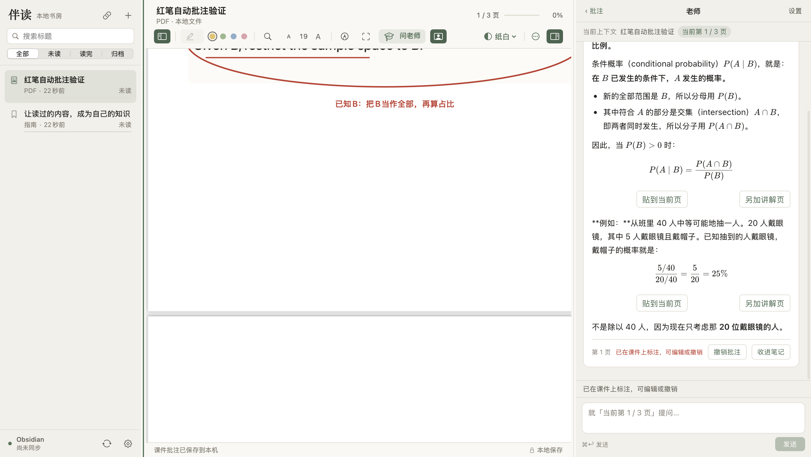

# deep-teach

**在原课件上学懂，再带着自己的笔记去复习。**

deep-teach（伴读）是一个原生 macOS 阅读与学习应用：打开 PDF 或 PPT，框出不懂的地方，老师在旁边解释，并直接在原页上用红笔圈注。学习过程会整理成可编辑的个人笔记，可以大屏复习、同步到 Obsidian，也能导出带批注的 PDF。

[下载安装](https://github.com/nathanzhang309-droid/deep-teach/releases/latest) · [English](README.en.md) · [使用指南](docs/USAGE.md) · [隐私说明](PRIVACY.md)



> 阅读和笔记可离线使用。AI 功能需要你自己的 Codex / Claude 订阅及对应 CLI 登录，消耗现有订阅额度；不包含免费 AI 服务，也不使用 API Key 计费。

## 能做什么

- **阅读书房**：PDF、PPT/PPTX、未加密 EPUB、Markdown、TXT、HTML 与网页文章；三种阅读主题、划线、搜索和阅读进度。
- **框选提问**：框住公式、图片或段落后直接进入聊天，选区留在课件上。
- **老师拿红笔**：回答完成后自动圈注、划线、画箭头和写透明短注；能编辑、按回答撤销、保存和导出。
- **学科图示**：逐步数学推导、Lewis 结构、概念关系图、函数滑块、图表和自测题。复杂图示可另加讲解页。
- **个人学习笔记**：相同知识点的追问归到一起，保留原问答与页码；支持个人补充、主动标记掌握和独立复习窗口。
- **Obsidian 同步**：单向写入本地 Markdown，保护手写区域；冲突另存，避免覆盖。
- **可调工作区**：书房、课件、老师／笔记栏可拖动调整比例，窗口布局自动记住。

## 中英文使用

在「设置 → 语言 / Language」选择「跟随系统 / 中文 / English」，立即切换界面、主菜单和新讲解的默认语言。原课件、已保存问答、笔记、输入草稿与测验选择保留原文。中文界面下也可以用英文提问；若希望老师换一种语言回答，请在问题中明确说明。

中文、英文、emoji 与混合语言标题均可保存和同步。文本文件支持 UTF-8 或带 BOM 的 UTF-16；其他编码请先转换，避免乱码。超长问题会保留草稿并提示缩短。Obsidian 的旧同步路径和内部数据标识保持兼容。

[双语对抗测试报告](docs/VALIDATION.md) 列出了实际复现的问题、修复和未覆盖范围。

## 安装

需要 **Apple Silicon Mac（M1 或更新）和 macOS 13+**。当前没有 Intel、Windows 或 Linux 版本。

1. 从 [Releases](https://github.com/nathanzhang309-droid/deep-teach/releases/latest) 下载 `deep-teach-1.3.0-macOS-arm64.zip`，解压后把 `伴读.app` 移到“应用程序”。
2. 应用采用 ad-hoc 签名，**尚未 Apple 公证**。macOS 可能提示无法验证开发者；确认下载来源后，可在“系统设置 → 隐私与安全”按系统提示允许打开，或自行从源码构建。
3. 导入课件开始阅读。PPT/PPTX 转换需要本机安装 Keynote；也可以先在 PowerPoint 导出 PDF。
4. AI 功能另需安装并登录 [Codex CLI](https://developers.openai.com/codex/cli/) 或 [Claude Code](https://code.claude.com/docs/en/overview)，在老师面板选择已登录的一方。CLI 未登录时，阅读仍可使用。
5. 如需 Obsidian 同步，在设置中选择自己的库。新安装默认不连接库、不自动同步；笔记输出到库内 `Bandu/`。

## 从源码构建

安装 Xcode Command Line Tools（`xcode-select --install`），然后：

```bash
git clone https://github.com/nathanzhang309-droid/deep-teach.git
cd deep-teach
bash build.sh
open build/伴读.app
```

首次构建从 Node.js 官方站下载固定版本运行时，并检查 SHA-256；它不包含任何 CLI 账号。已经编译好的老师前端随源码提供，所以原生构建不要求 npm。

修改老师前端时，需要 Node.js 24 与 npm：

```bash
cd TeacherUI
npm ci
npm run build
cd ..
bash build.sh
```

测试核心存储、同步、布局、双语请求和异常输入（先在 TeacherUI 中执行 `npm ci`，需 Node.js 24）：

```bash
bash scripts/test.sh
```

GitHub Actions 会运行这些测试、重建前端并编译 Mac App。原生界面与真实模型测试另见 [开发与验收](docs/DEVELOPMENT.md)，不会在 CI 中使用维护者的订阅。

## 数据和隐私

数据保存在 `~/Library/Application Support/BanduLibrary/`。没有伴读账号、托管后端或内置遥测。**调用老师时，相关课件和对话会发送给你选择的模型服务**；自动学习笔记整理也会使用该服务。完整范围见 [PRIVACY.md](PRIVACY.md)。不要把资料库、课程文件、聊天、登录配置或密钥提交到仓库。

旧版资料可继续读取，原始 PDF/PPT 不修改。导出的 PDF 将批注固化；继续编辑请保留伴读资料库并使用“文件 → 导出资料库备份”。

## 当前边界

- 模型可能理解或标错内容；自动笔记和红笔批注需要核对，不能据追问次数判断掌握程度。
- 扫描 PDF 可框图提问，但没有独立的离线 OCR；图像中的空白位置依赖模型识别。
- 手动贴入的公式、图表是静态图片，可移动缩放，不能编辑内部公式或化学键。
- PPT 转换依赖 Keynote；复杂排版可能变化。EPUB 不支持 DRM。动态／登录网页不保证提取成功。
- Obsidian 是单向文件同步；不提供伴读自己的跨设备云同步。
- CLI 协议和订阅可用性可能变化；本项目与 OpenAI、Anthropic、Obsidian、Apple 无隶属关系。

## 参与和许可

欢迎提交问题和改进，见 [CONTRIBUTING.md](CONTRIBUTING.md)。截图和复现材料请使用合成课件，先移除个人信息。

项目代码与教学提示采用 [MIT](LICENSE)。第三方库与字体保留各自许可证，详见 [THIRD_PARTY_NOTICES.md](THIRD_PARTY_NOTICES.md)。界面设计由 Claude Opus 5.5 协助完成，工程实现与验证由 Codex 协助完成。
