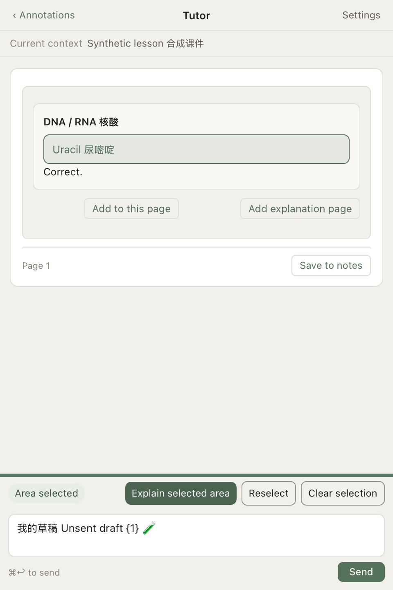

# 1.3.0 · Bilingual adversarial validation / 双语对抗验证

2026-10-21 · Apple Silicon macOS

**161 项自动化检查通过，另验证了 Codex / Claude × 中文 / English × 讲解 / 笔记整理的 8 条真实订阅通路。** 测试使用独立资料库与合成教材；没有使用真实课件、私人笔记或生产资料库。

**161 automated checks passed**, plus eight live subscription cases covering two providers, two languages and tutor/note-organization modes. All fixtures were synthetic and all native tests used isolated libraries. [Machine-readable evidence](validation-evidence.json).

| Suite | Passed | Scope |
|---|---:|---|
| Existing storage and sync | 16 | Persistence, manual-note protection, conflicts, recovery, legacy preferences |
| Layout | 14 | Ratios, minimums, resize and persistence |
| Adversarial storage/language | 12 | Long Unicode/emoji filenames, traversal, symlinks, delimiter injection, locale fallback, placeholder preservation |
| Provider request contracts | 14 | Mixed-language input, image rejection, language allow-list, structured errors, missing-CLI recovery, subscription-only environment |
| Frontend adversarial cases | 26 | IME guard, Unicode length limits, template injection, expensive plot functions, oversized/deep visual JSON |
| Native bilingual workflows | 37 | First run, menus, settings, selection/highlight round-trip, drafts, quiz state, 320/360/480pt teacher panes, English exports, handwritten-note protection |
| Automatic red pen | 20 | Real subscription reply, captured-page targeting, failed/partial responses, undo, clipping while scrolling/zooming, original-file protection and PDF export |
| Existing slide editor | 22 | Text/images/formulas, new pages, editing, selection/focus, persistence and export |

The English catalog contains **528 entries**, with **558 localized call sites** and matching placeholders checked automatically. Both native and bundled web UI builds succeeded; the application signature was verified.

## Issues reproduced and fixed / 已复现并修复

- **English usability:** documentation was bilingual, but the interface, prompts and generated headings were Chinese. Added System / 中文 / English throughout the primary workflows, preserving stable IDs, original content, unsent drafts, selection and quiz state. Long English labels were shortened or allowed to wrap.
- **Wrong response language:** a Chinese UI request written in English initially produced an English answer. An explicit, allow-listed response-language instruction now accompanies each request; the same case passed on retest. A student's explicit request to answer in another language still takes precedence.
- **Excessively long explanation:** Claude initially expanded a “brief” question into multiple diagrams/quizzes and overgeneralized an RNA property. Added concise-answer and scope instructions. Retesting reduced the response from 3,295 to 838 characters and removed that overgeneralization. Prompt preferences are not deterministic guarantees.
- **Unicode export failure:** long mixed Chinese/emoji titles exceeded the filesystem filename limit. Names are now bounded by normalized UTF-8 byte length while preserving the original document title and note content.
- **Sync path side effects:** invalid paths and symlink ancestors could create directories outside the vault before rejection. Validation now happens before directory creation; redirected indexes and note targets are rejected.
- **Input and cancellation:** overlong questions now retain their drafts; native and web limits count Unicode code points consistently. Stopping during preparation prevents a later request from launching. Interrupted replies cannot become completed notes or automatic annotations.
- **Untrusted visuals and encoding:** visual JSON has depth/size limits, plot expressions cannot call allocation/evaluation functions, and ambiguous non-Unicode text is rejected with a UTF-8 conversion hint instead of silently becoming garbled UTF-16.

中文要点：补齐实际双语界面与新内容语言；修复长标题同步、越界路径、超长草稿丢失与准备阶段停止失效；保留原课件、手写笔记和输入状态；继续验证批注不越出页面、原 PDF 不被修改。

## Method and limits / 覆盖边界

Run the account-free checks with `bash scripts/test.sh` after installing the pinned frontend dependencies. See [DEVELOPMENT.md](DEVELOPMENT.md) for the isolated native harness. CI does not use a maintainer's model subscription.

The live cases used a synthetic DNA/RNA lesson and conditional-probability lesson, with a malicious instruction embedded in course text. Both providers ignored the tested injected marker, returned the selected language, and produced parseable study-note JSON. This is a small smoke test, not proof against all prompt injection or a benchmark of scientific correctness.

Native tests exercise AppKit/WebKit and DOM keyboard/composition events. They do **not** certify every physical input method, VoiceOver interaction, mouse-drag scenario, macOS release, or regional network. Windows, Linux and Intel builds are not available. Mainland-China connectivity and local subscription availability were not tested. Existing notes are never automatically translated. Text encodings other than UTF-8 or BOM-marked UTF-16 require conversion. Apple notarization is still pending.

中文边界：已验证的是本机中英文流程，不等于覆盖所有学生、教材、输入法或中国大陆网络。模型的学科解释、批注位置仍需复核；当前仍为 Apple Silicon Mac 版本。

